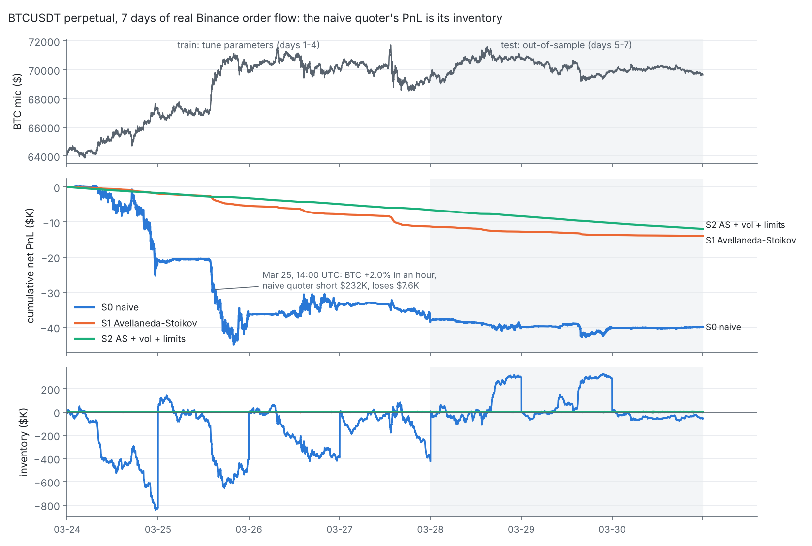
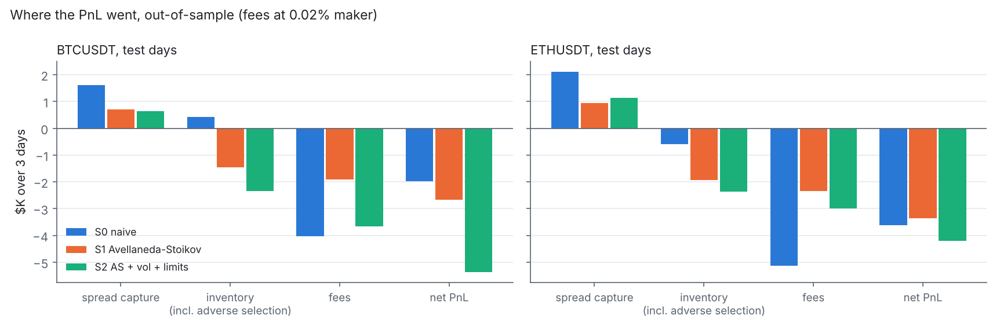
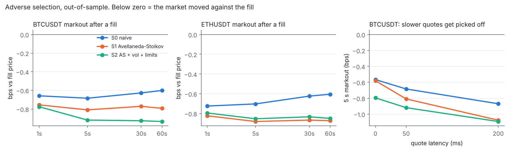
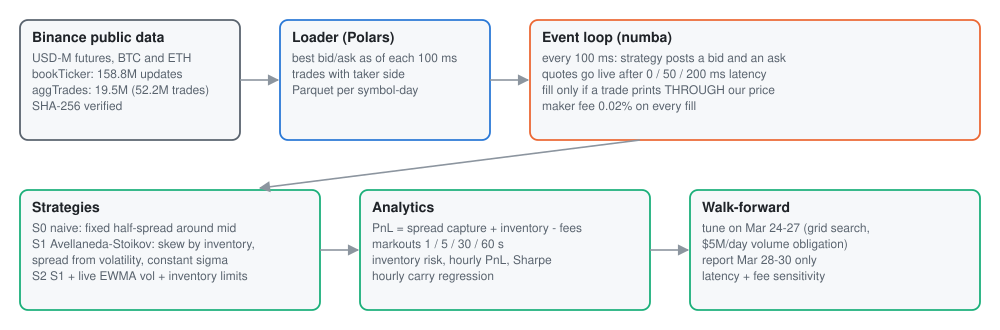

<div align="center">

# Crypto Market-Making Backtester

**Two market makers, a week of real Binance BTC and ETH perpetual order flow, and an honest account of where the money went.**
<br>An event-driven backtester (Polars + numba) that replays 158.8M best-bid/ask updates and 52.2M trades. It runs a naive symmetric quoter against Avellaneda-Stoikov inventory-aware quoters, with parameters tuned on 4 days and results reported on the next 3.

[](https://github.com/Jitesh-Mishra/crypto-market-making-backtester/actions/workflows/ci.yml)


| **-99%** | **-91%** | **0.93** | **2.5x** |
|:---:|:---:|:---:|:---:|
| max inventory with Avellaneda-Stoikov vs naive, out-of-sample ($328K to $3.8K on BTC) | hourly PnL volatility, same comparison ($536 to $49 per hour on BTC) | R² of the naive quoter's hourly PnL on inventory carry: its PnL *is* a directional bet | the 0.02% maker fee vs the 0.8 bps of spread the naive quoter captured per dollar. Every strategy loses after fees |

<sub>Backtest. Simulated fills, no queue position: a quote fills only when a trade prints through it. Every number below comes from `reports/`.</sub>

</div>

<picture>
  <source media="(prefers-color-scheme: dark)" srcset="docs/img/week-dark.png">
  
</picture>

> **The honest result.**
> - **Inventory: Avellaneda-Stoikov did its job.** Out-of-sample it cut max inventory by 99% and hourly PnL volatility by 91%.
> - **Profit: it didn't make money, and neither did anything else.**
>   - Under a conservative fill model, every strategy's fills are underwater: markouts sit between -0.6 and -0.9 bps at every horizon from 1 s to 60 s.
>   - The 0.02% retail maker fee is about 2.5 times the 0.7 to 0.8 bps of spread S0 and S1 capture per dollar traded.
>   - On the 3 test days the naive quoter lost *less* on BTC (-$2.0K vs -$2.7K), but only because a $328K position happened to mean-revert.
>   - On the 4 training days the same quoter lost $37.9K, against $11.3K for Avellaneda-Stoikov.
> - **The main lesson.** Spread capture is the easy part. Inventory and adverse selection decide the PnL, and the fee tier decides whether market making is a business at all.

## What I learned about market making

1. **A naive market maker is a momentum-loser in disguise.**
   - It keeps buying into a falling price and selling into a rising one, so a trend leaves it holding the wrong side.
   - Its hourly PnL is explained 93% (BTC) and 95% (ETH) by `inventory at the start of the hour × price move` (`reports/regime.json`).
   - Worst hour, Mar 25 14:00 UTC: BTC rallied 2.0% in an hour while the naive quoter was short $232K, and it lost $7,622. Avellaneda-Stoikov lost $963 in the same hour; S2 lost $1.50.
2. **Inventory control is what Avellaneda-Stoikov buys you, not edge.**
   - Skewing quotes against inventory keeps the book near flat: mean absolute inventory was $263 vs $95,613 for the naive quoter on BTC.
   - The price: S1 and S2 lost money in every single test hour. They pay a small, steady toll to get out of positions, instead of taking big random swings.
3. **Fills are adversely selected by construction.**
   - Under a trade-through fill model you only trade when the market has already moved through your price.
   - 74 to 85% of fills saw the mid move against them within 5 s. 5-second markouts were -0.68 to -0.92 bps.
   - Real makers at the front of the queue get fills without a trade-through. That is exactly the edge this backtest can't credit, so these PnLs are a lower bound.
4. **Latency is adverse selection.** Going from 0 to 200 ms quote latency nearly tripled BTC fills (25,018 to 71,415). Stale quotes get picked off, and the 5 s markout worsened from -0.57 to -0.87 bps (S0) and from -0.58 to -1.08 bps (S1).
5. **Fees decide the business.** Using the same fills:
   - At a 0% maker fee, the naive quoter would have made +$2,038 on BTC over the test days.
   - With a 0.5 bps rebate it would have made +$3,044, and the Avellaneda-Stoikov losses shrink to $267 to $792.
   - That is why real market makers live on rebate tiers.

## Results (out-of-sample: Mar 28 to 30, 2024)

Quote size $1,000; maker fee 0.02%; quote latency 50 ms; each day starts flat and ends marked to mid. Parameters for all three, baseline included, came from the same grid search on Mar 24 to 27.

| | BTC S0 naive | BTC S1 AS | BTC S2 AS+vol+limits | ETH S0 naive | ETH S1 AS | ETH S2 AS+vol+limits |
|---|---:|---:|---:|---:|---:|---:|
| Fills | 37,662 | 17,585 | 37,708 | 59,239 | 26,227 | 35,065 |
| Volume | $20.1M | $9.6M | $18.3M | $25.7M | $11.7M | $14.9M |
| Spread capture | +$1,620 | +$700 | +$631 | +$2,116 | +$935 | +$1,148 |
| Inventory (incl. adverse selection) | +$418 | -$1,445 | -$2,339 | -$598 | -$1,938 | -$2,356 |
| Fees | -$4,023 | -$1,911 | -$3,665 | -$5,134 | -$2,345 | -$2,985 |
| **Net PnL** | **-$1,985** | **-$2,656** | **-$5,373** | **-$3,616** | **-$3,348** | **-$4,194** |
| Net PnL per $1M volume | -$99 | -$278 | -$293 | -$141 | -$286 | -$281 |
| **Max abs inventory** | **$328,065** | **$3,754** | **$4,658** | **$279,906** | **$3,627** | **$4,530** |
| Hourly PnL std | $536 | $49 | $17 | $477 | $41 | $23 |
| Worst hour | -$3,407 | -$271 | -$107 | -$2,436 | -$247 | -$123 |
| Hourly Sharpe (not annualized) | -0.05 | -0.76 | -4.50 | -0.11 | -1.13 | -2.57 |
| 5 s markout | -0.68 bps | -0.81 bps | -0.92 bps | -0.70 bps | -0.88 bps | -0.85 bps |
| Fills adversely selected (5 s) | 75.5% | 74.4% | 85.2% | 75.0% | 75.6% | 79.0% |

<sub>`reports/results_test.csv`, per day in `reports/results_test_by_day.csv`. Spread capture = distance of the fill from mid. Inventory = everything else before fees, which mixes adverse selection (seconds) and directional exposure (hours).</sub>

<picture>
  <source media="(prefers-color-scheme: dark)" srcset="docs/img/decomposition-dark.png">
  
</picture>

**Same strategies, both periods** (`reports/regime.json`; the training days are in-sample):

| Net PnL | BTC S0 | BTC S1 | BTC S2 | ETH S0 | ETH S1 | ETH S2 |
|---|---:|---:|---:|---:|---:|---:|
| Train, Mar 24 to 27 (trending: BTC +8.6%, ETH +5.2%) | -$37,918 | -$11,272 | **-$6,572** | -$31,056 | -$10,338 | **-$7,219** |
| Test, Mar 28 to 30 (ranging: BTC +0.2%, ETH +0.1%) | **-$1,985** | -$2,656 | -$5,373 | -$3,616 | **-$3,348** | -$4,194 |

The ranking flips between regimes for the naive quoter, and not for the inventory-aware ones: their losses are about the same size in both. That's what lower risk looks like.

<picture>
  <source media="(prefers-color-scheme: dark)" srcset="docs/img/markouts-dark.png">
  
</picture>

## How it works

<picture>
  <source media="(prefers-color-scheme: dark)" srcset="docs/img/architecture-dark.svg">
  
</picture>

**Data** (`mmbt/data.py`)
- Binance USD-M futures daily files for BTCUSDT and ETHUSDT, Mar 24 to 30, 2024, from data.binance.vision. Each zip is checked against Binance's SHA-256.
- Totals: 158,759,121 best-bid/ask updates and 19,498,723 aggregated trades (52,248,784 individual trades, $182B notional).
- The week is fixed by the data: Binance stopped publishing futures `bookTicker` files after Mar 30, 2024.
- Polars turns each day into a best bid/ask grid at every 100 ms (as of, never ahead) plus a trade table with the taker side.

**Simulator** (`mmbt/sim.py`, numba, about 0.3 s per symbol-day)
- Every 100 ms the strategy posts one bid and one ask, live after a 0, 50 or 200 ms latency.
- A bid fills only when a seller-initiated trade prints strictly below it, and an ask only when a buyer-initiated trade prints strictly above it. So there is no queue position, and no fills at our level from trades that merely touch it.
- Fill size is capped by the trade's size. Quotes are post-only and rounded away from mid to the tick.
- Trades at the same millisecond as a decision are processed first, so a quote never trades against a print it has already seen.

**Strategies**
- **S0 naive:** bid and ask at a fixed half-spread around mid.
- **S1 Avellaneda-Stoikov:**
  - Reservation price `mid × (1 - q·γ·σ²·τ)`, with inventory q in $1,000 lots and τ = 30 s.
  - Half-spread `½γσ²τ + (1/γ) ln(1 + γ/κ)`.
  - σ is held constant at the training-days median (0.86 bps per √s for BTC).
- **S2:** S1 with σ from a causal 60 s EWMA of 100 ms returns, plus hard inventory limits: it stops quoting the side that would push |q| past the limit.

**Evaluation** (`mmbt/experiment.py`)
- 67 settings per symbol (7 for S0, 20 for S1, 40 for S2) were grid-searched on the 4 training days. The objective was the best net PnL among settings meeting a **$5M/day volume obligation**, like an exchange market-maker program. Without it, the "best" quoter is one so wide it never trades.
- The test days are reported once, with no retuning.
- Also reported: latency sensitivity, fee what-ifs, and every grid setting on the test days as a robustness view (`reports/frontier_test_all_settings.csv`). Those are not used for selection.

## Run it

```bash
pip install -r requirements.txt
pytest -q                      # 7 simulator tests on hand-built event streams (fill rule, latency, accounting, AS skew, limits)
python -m mmbt.data            # downloads about 1.2 GB from data.binance.vision, 3 min
python -m mmbt.experiment      # tuning + test + latency + robustness, about 5 min on 2 CPUs
python -m mmbt.regime          # hourly attribution over all 7 days
python scripts/make_figures.py
```

## Limitations
- **No queue position.** The trade-through rule never credits fills at the front of the queue. That is the main source of a real maker's edge, so absolute PnL here is pessimistic. The strategy *comparison* is the point.
- **No market impact.** Our quotes don't change the book, and $1,000 quotes are small next to BTC's top-of-book size.
- **One week, March 2024.** That's what Binance publishes for futures `bookTicker`. One trending regime and one ranging regime is not a distribution.
- **100 ms decision grid.** Real makers requote on every book event.
- **Days are independent:** each starts flat and is marked to mid at midnight.

## Next
- A queue-position fill model (estimate position from the displayed size at our level).
- An order-flow imbalance signal to skew quotes before the move, not after.
- Fee-tier analysis as a first-class axis.
- A Streamlit replay of one day.

---
<sub>**Stack:** Python, Polars, NumPy, numba, matplotlib, pytest, GitHub Actions. **Data:** [Binance public market data](https://data.binance.vision). Backtest only; simulated fills; not investment advice.</sub>
